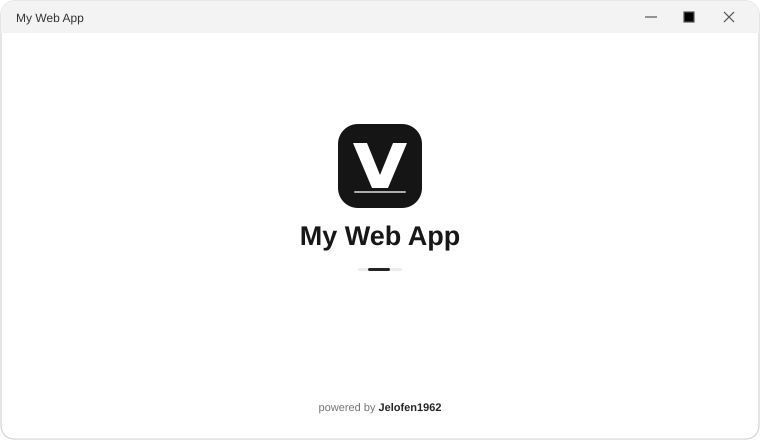

<div align="center">
  <a href="https://github.com/Jelofen1962/RWV"></a>
  <h3>One URL. Your choice of platforms.</h3>
  <p>Native website wrappers for Windows, Linux and Android.</p>
  <a href="https://github.com/Jelofen1962/RWV/actions">GitHub Actions</a> · <a href="https://github.com/Jelofen1962">Made by Jelofen1962</a>
</div>

## Build in GitHub Actions (recommended)

1. Extract this source package and push its contents, including the hidden `.github` folder, to your repository. Keep `Cargo.toml` and `.github/` at the repository root.
2. Open **Actions → Build with RWV → Run workflow**. The workflow must exist on the default branch to appear in the Actions UI. Enable Actions if necessary.
3. Enter the name, version, icon and website URL. Tick **Windows**, **Linux**, **Android**, or any combination. Windows is initially checked for backward compatibility; untick it if not needed.
4. Click **Run workflow**. The selected native jobs run independently after shared input validation. Unselected jobs are skipped; selecting none fails validation with an explanation.
5. After a successful build, open the run's **Artifacts** area and download the packages you selected. Each Actions artifact is itself delivered as a ZIP.

| Workflow input | Meaning / example |
|---|---|
| `app_name` | My Dashboard |
| `app_version` | 1.0.0 (1–4 numeric components, each 0–65535) |
| `icon_source` | icons/example.png or a publicly reachable PNG URL |
| `website_url` | https://example.com or http://192.168.1.10:3355 |
| `windows` | Checkbox, Windows x64 EXE |
| `linux` | Checkbox, Linux x64 tar.gz |
| `android` | Checkbox, universal Android APK |
| `trust_http_origin` | Windows-only development option; default off |
| `android_id` | Optional explicit package ID, e.g. com.example.dashboard |
| `android_version_code` | Positive integer, increase when building Android updates |

| Platform | Output | Runtime |
|---|---|---|
| Windows | `<name>-<version>-windows-x64.exe` | Windows 10/11 + Edge WebView2 Evergreen |
| Linux | `<name>-<version>-linux-x64.tar.gz` | GTK 3 + WebKitGTK 4.1; graphical desktop |
| Android | `<name>-<version>-android-universal.apk` | Android 6.0/API 23+ with Android System WebView |

Windows and Linux use the same Rust/Tao/Wry implementation, icon, splash and branding. Android uses a small native Java Activity with Android System WebView, matching the app name, icon, splash and persistent cookies/storage. There is no bundled Chromium or Electron. Android supports system Back navigation and the system file picker; device permissions, downloads, external protocols, popups and special browser APIs are not guaranteed. The Android WebView does not expose a privileged native JavaScript bridge.

## Android signing and updates

The default APK is a non-debuggable release build signed with Gradle's debug key for sideloading. It is installable, but a new GitHub-hosted runner may use a different key. Android will reject an update if the signing key differs; uninstalling the old app removes its stored data. For reliable updates, configure the following **repository Actions secrets** (all four or none):

- `RWV_ANDROID_KEYSTORE_BASE64`: base64 of your existing Java keystore file (single-line).
- `RWV_ANDROID_KEYSTORE_PASSWORD`: keystore password.
- `RWV_ANDROID_KEY_ALIAS`: signing alias.
- `RWV_ANDROID_KEY_PASSWORD`: key password.

Keep the same application ID and signing key and increase `android_version_code` for updates. The automatic package ID is deterministic from the app name and website origin, not the version or page path. For a permanent package identity even when the name or origin changes, set `android_id` explicitly. Back up your signing key securely. The builder decodes it into a temporary directory and removes it after Gradle exits. Never commit private keys. This workflow builds APKs for sideloading, not a Play Store AAB or store-compliant publishing release (target SDK 34, compile SDK 35).

## Local builds

Python 3.12 is recommended; install the shared build dependency first:

```sh
python -m pip install -r requirements-build.txt
```

On a native Windows host (Rust stable, MSVC C++ Build Tools and Windows SDK required):

```powershell
python scripts/build.py --platform windows --name 'My App' --version 1.0.0 --icon icons/example.png --url https://example.com
```

The original Windows-only interactive `build.cmd` / `build.ps1` is also preserved. It supports `-RunTests`, custom PNGs, and the original ARM64 target option. The shared Python builder accepts `--target aarch64-pc-windows-msvc` if you install ARM64 MSVC tools; ARM64 execution tests require an appropriate host.

On Ubuntu 22.04 or compatible Linux (Rust stable and system build libraries):

```sh
sudo apt update
sudo apt install build-essential pkg-config libgtk-3-dev libwebkit2gtk-4.1-dev libxdo-dev
python scripts/build.py --platform linux --name 'My App' --version 1.0.0 --icon icons/example.png --url https://example.com
```

The archive is dynamically linked. Extract it, install runtime libraries (see the included README), then launch `./rwv` from a graphical desktop. It is not an AppImage or a universal static binary. Distribution compatibility depends on system libraries and glibc. The GitHub workflow uses Ubuntu 22.04 to target that baseline. ARM64 can be built on an ARM64 Linux host using `--target aarch64-unknown-linux-gnu` with native dependencies.

For Android, install JDK 17, Gradle 8.9, Android SDK command-line tools, platform 35 and build tools 35.0.0. Make `gradle` available on PATH and configure `ANDROID_HOME`.

```sh
sdkmanager 'platforms;android-35' 'build-tools;35.0.0'
python scripts/build.py --platform android --name 'My App' --version 1.0.0 --icon icons/example.png --url https://example.com --android-version-code 1
```

Outputs land in `dist/` unless `--output` is supplied. `--prepare-only` generates configuration and icons without compiling; `--validate-only` validates inputs without downloading an icon or compiling. The optional signing environment variables above also work locally. Do not run simultaneous builds of the same platform in a single checkout; they share generated configuration and compiler output. The three GitHub jobs use separate checkouts, so selecting multiple platforms is safe.

## Network and local URLs

- The app packages the URL, not the website. Its website must be running and reachable from the target device.
- For Android on a physical phone, use a reachable LAN IP/hostname instead of a PC's `localhost`. The Android emulator can use `10.0.2.2` for its host PC. A LAN server may need to listen on `0.0.0.0` and allow the port through the firewall.
- Desktop supports absolute `file:///` URLs for existing files on the destination computer. Android intentionally rejects them; select only desktop for such builds.
- HTTP works on all platforms for an HTTP-configured app. On Android this opts the generated manifest into cleartext traffic; HTTPS-configured apps do not allow cleartext. TLS validation is never bypassed. Windows can optionally treat the configured HTTP origin as a secure context for development; Linux/Android do not apply that Chromium-specific flag. Use HTTPS in production.
- Windows profiles retain the original `%LOCALAPPDATA%/RustWebViewApps/<identity>/WebView2` path. Linux profiles use `$XDG_DATA_HOME/RustWebViewApps/<identity>/WebKitGTK` (or `~/.local/share`). Android uses the normal private app WebView storage.
- Windows EXEs are unsigned and can trigger SmartScreen. Linux packages are unsigned. Android APKs are signed as described above.

## Tests and verification

```sh
python -m unittest discover -s tests -v
```

The workflow validates the inputs and runs shared Python tests, then runs Rust unit tests before desktop release builds, verifies Windows EXE metadata and Linux binary dependencies, and runs Android JVM tests, lint and APK signature verification. The workflow uploads an artifact only after its selected job succeeds. Native runtime testing on actual target devices is still recommended. Cargo dependencies are resolved on the first build; commit the generated Cargo.lock to pin future dependency versions.

## Source layout

```text
.github/workflows/build-webview.yml  # platform checkboxes and independent jobs
scripts/build.py                    # shared configuration and build orchestration
tests/test_builder.py               # shared builder unit tests
src/                                # Rust desktop wrapper
build.rs                            # embedded config, icons and Windows metadata
build.cmd / build.ps1               # original Windows interactive builder
android/                            # native Android Gradle app
icons/                              # example icon
docs/                               # original artwork and Linux runtime instructions
```

<div align="center"><br><sub>Powered by Jelofen1962</sub></div>
