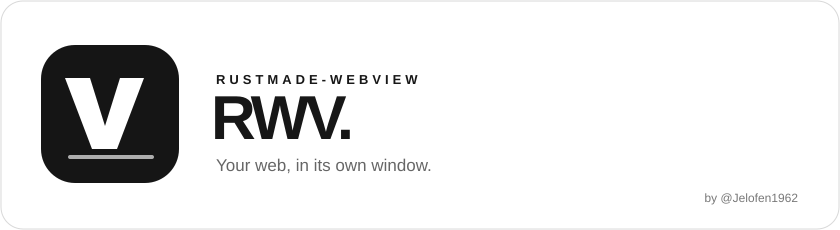

<div align="center">
  <a href="https://github.com/Jelofen1962/RWV"></a>

  <p><b>One URL. One EXE. That's it.</b></p>
  <p>A tiny Rust project that turns websites and local dashboards into native Windows apps.</p>

  [](https://www.rust-lang.org/)
  [](https://www.microsoft.com/windows/)
  [](https://developer.microsoft.com/microsoft-edge/webview2/)
  [](https://github.com/Jelofen1962/RWV/actions)

  [Quick start](#-quick-start) · [Build in the cloud](#-build-in-the-cloud) · [Stack](#-the-stack) · [Contact](#-made-by)
</div>

---

## ✦ What's RWV?

**Rustmade-WebView** wraps a website in a native Windows window and packages it as a customized `.exe`. Give it a name, a version, a PNG and a URL. RWV handles the rest.

I wanted something simple for local dev servers, personal tools and web dashboards without spinning up an entire Electron project. No npm install, no bundled Chromium, no extra config files to carry around. Just Rust and the WebView2 runtime.

<div align="center">
  
  <br><sub>Startup screen design · Your own icon and title replace the example above.</sub>
</div>

## ✦ What you get

| | Feature |
|:--:|:--|
| 🪟 | Native, resizable Windows window with your own app title |
| 🎨 | PNG from a local file or a URL, embedded as a multi-size Windows icon |
| ✨ | White startup screen with your icon, app name and Poppins typography |
| 🌐 | HTTP, HTTPS, localhost, LAN servers and local `file:///` pages |
| 💾 | Persistent cookies, browser storage and a separate profile per app identity |
| 🛠️ | DevTools, zoom shortcuts and the regular WebView2 web platform |
| 📦 | One app EXE, with name, version and icon compiled in |
| ☁️ | Manual GitHub Actions build, no local Windows compiler required |

## ✦ Quick start

You'll need **Windows**, [Rust stable](https://rustup.rs/) and [Visual Studio Build Tools](https://visualstudio.microsoft.com/downloads/) with the **Desktop development with C++** workload and Windows SDK. On first build, Cargo downloads the dependencies.

Clone the project and run the builder:

```powershell
git clone https://github.com/Jelofen1962/RWV.git
cd RWV
.\build.cmd
```

> If you're using the source ZIP, just extract it and run `build.cmd` instead.

```text
RWV / Rustmade-WebView
by @Jelofen1962 | github.com/Jelofen1962

Application name: My Dashboard
Application version: 1.0.0
PNG icon: .\icons\example.png
Website URL: http://localhost:3000
Treat this HTTP origin as secure? [y/N]: n
```

Your executable lands in `dist/` as `My Dashboard-1.0.0-windows-x64.exe`. The icon can be a local path, `file:///` URL or HTTP(S) PNG URL. Square transparent PNGs at 256×256 or larger work nicely. Versions contain one to four numeric components, each between 0 and 65535.

<details>
<summary><b>Prefer a one-liner or scripting?</b></summary>

```powershell
.\build.ps1 -AppName 'My Dashboard' -AppVersion '1.0.0' `
  -IconSource '.\icons\example.png' `
  -WebsiteUrl 'http://localhost:3000' -NonInteractive
```

Use `-RunTests` to run Rust unit tests before compilation. For ARM64, install the appropriate MSVC ARM64 tooling and add `-Target aarch64-pc-windows-msvc`. If script execution is blocked, run `build.cmd` from a trusted checkout.

</details>

## ✦ Build in the cloud

No compiler installed? GitHub can do the Windows build for you.

1. Push or fork this project to your GitHub repository, including `.github/`.
2. Open **Actions → Build with RWV → Run workflow**. Enable workflows if GitHub asks.
3. Fill in the fields below and hit **Run workflow**.
4. Open the successful run and download the `RWV-windows-x64-<run-id>` artifact.

| Input | Example |
|:--|:--|
| `app_name` | `My Dashboard` |
| `app_version` | `1.0.0` |
| `icon_source` | `icons/example.png` or `https://example.com/icon.png` |
| `website_url` | `http://localhost:3000` |
| `trust_http_origin` | `false` (default) |

The workflow runs Rust tests, builds the EXE, checks the embedded Windows metadata and uploads the binary for 30 days. GitHub artifacts are downloaded as ZIPs.

**Local URLs are fine.** GitHub doesn't need to visit the website you're packaging. Your computer opens it when you launch the EXE. An icon URL, on the other hand, has to be accessible to the runner. For an offline icon, commit the PNG to the repo and enter its relative path. Don't put secrets in workflow inputs or URLs.

## ✦ The stack

| Tool | What it does |
|:--|:--|
| [Rust](https://www.rust-lang.org/) | The actual app, no JS desktop runtime |
| [Tao](https://github.com/tauri-apps/tao) | Native window and event loop |
| [Wry](https://github.com/tauri-apps/wry) | Rust bindings for the embedded webview |
| [WebView2](https://developer.microsoft.com/microsoft-edge/webview2/) | Microsoft Edge's web engine |
| [image](https://github.com/image-rs/image) + [winres](https://github.com/mxre/winres) | PNG processing, ICO and EXE resources |
| [Poppins](https://fonts.google.com/specimen/Poppins) | Startup screen typography |
| PowerShell + GitHub Actions | Local builds and cloud builds |

## ✦ A few details worth knowing

<details>
<summary><b>HTTP and local development</b></summary>

Normal HTTP is supported out of the box. Loopback URLs such as `http://localhost:3000` are generally already treated as potentially trustworthy by Chromium. For trusted non-loopback development servers, enable `-TrustHttpOrigin` (or the workflow checkbox) to pass `--unsafely-treat-insecure-origin-as-secure` for that exact origin and port only.

This does not encrypt traffic, bypass TLS certificate validation or CORS, grant permissions, or disable sandbox protections. Stick with HTTPS for production. For `file:///C:/app/index.html`, the file has to exist on the target computer; RWV packages the URL, not the website files.

</details>
<details>
<summary><b>Browser stuff and persistent sessions</b></summary>

WebView2 provides JavaScript, localStorage, IndexedDB, WebSockets, fetch, forms and file inputs. Device permissions, downloads, popups, DRM, screen sharing, WebAuthn and other special features remain subject to Wry, WebView2, the website and OS policies; RWV is not a complete Edge browser or a permissions bypass. There is no privileged JS-to-native bridge.

Profiles live in `%LOCALAPPDATA%\RustWebViewApps\<identity>\WebView2`. The legacy folder name keeps sessions from earlier builder versions intact. Rebuild with the same app name and origin to keep cookies; changing either creates a separate profile. For `file:///` apps, the full URL is used. Close all instances before deleting a profile or changing browser flags for that profile.

</details>
<details>
<summary><b>The splash and console signature</b></summary>

The startup screen embeds the app's PNG, uses Poppins through Google Fonts and displays **powered by Jelofen1962** at the bottom. It runs in the same webview as the site. A short nonblocking timer opens the configured URL after the splash loads, with a five-second fallback if external font loading stalls. If Google Fonts is unavailable, Segoe UI is used instead.

Each new top-level web document gets a small styled DevTools console signature with creator links and contact details. It does not edit the target page, add tracking, or send its contents anywhere. DevTools controls its own font availability, so the console's Poppins font-family hint may fall back to the browser's console font. SPA route changes stay in the same document and do not print duplicate signatures. A site can clear or override its console.

</details>
<details>
<summary><b>Runtime, unsigned EXEs and troubleshooting</b></summary>

The target computer needs Microsoft's [WebView2 Evergreen Runtime](https://developer.microsoft.com/microsoft-edge/webview2/). It's commonly present on Windows 10/11. RWV does not bundle Chromium or a runtime installer, and the generated EXE is not code-signed. Windows SmartScreen may warn about it.

If builds fail, check the Rust toolchain and C++ workload first. Use the build scripts rather than bare `cargo build`, since they provide the app configuration and PNG. Cargo generates a lockfile at the first successful resolution; commit that lockfile to pin future builds. If a website doesn't load, make sure it is reachable from the target PC.

</details>

## ✦ Project layout

```text
RWV/
├── .github/workflows/    # build, test, upload
├── docs/                # README artwork
├── icons/               # sample PNG
├── src/
│   ├── ui/
│   │   ├── console.js   # little creator signature
│   │   └── splash.html  # startup screen
│   ├── config.rs        # config validation
│   └── main.rs          # native window + webview
├── build.cmd            # double-click to build
├── build.ps1            # the actual build flow
├── build.rs             # icon + Windows metadata
└── Cargo.toml
```

## ✦ Made by

<div align="center">
  <h3>Jelofen1962</h3>
  <p>Building small tools that make the everyday stuff a bit less annoying.</p>

  [](https://github.com/Jelofen1962)
  [](https://t.me/jelofen1962)

  <sub>If RWV saves you some time, a star is always appreciated.</sub>
</div>
